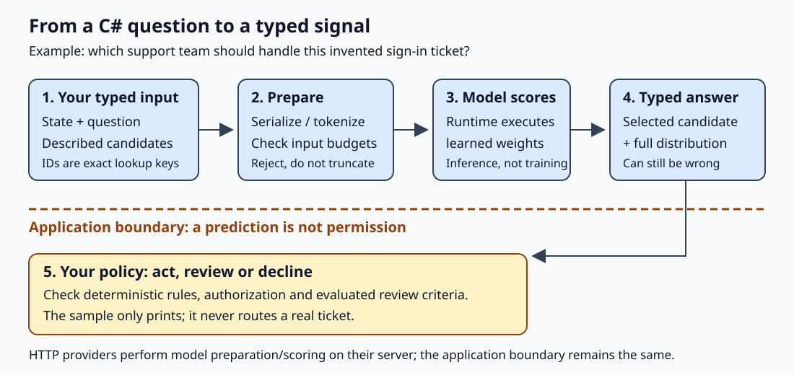

# 1. From C# rules to a learned decision

[Learning path](README.md) | Next: [reading answers](02-reading-answers.md)

## Begin with a business problem, not a model

Imagine a help desk with three teams: account access, billing and technical
support. A customer writes "I cannot sign in after resetting my password."
Your program needs a category; it does not need a paragraph of advice.

If your system already has an authoritative `IssueType` enum from a structured
form, use ordinary C# rules. They are cheap, inspectable and exact. Similarly,
whether an invoice is overdue given a due date is usually arithmetic, not a
model question. Do not replace deterministic facts, permissions or legal
requirements with probabilistic guesses.

Free text is harder. "Can't log in", "password reset failed", and "locked out"
may describe the same issue without sharing a literal keyword. A **learned
model** contains numeric weights adjusted on examples during **training**.
At **inference** time it uses those fixed weights to score new input. The
quickstarts only do inference. Editing a question does not retrain the model;
loading a file is not training either.

This flexibility introduces a tradeoff: the program can accept varied wording,
but a valid, confidently selected category can still be wrong. Treat inference
as an uncertain signal you must evaluate, not a shortcut to authoritative truth.

## Three things your code supplies

**State** is the information to assess: here a synthetic ticket string. It can
also be a typed object serialized as JSON. More data is not automatically better:
irrelevant text consumes space and may distract the model. Never include secrets
or personal data merely because a serializer can represent them.

**A question** defines one task: "Which support team should handle this ticket?"
Its ID, `"support-team"`, is a stable application key to retrieve the result.
It does not supply missing meaning.

**Candidates** describe the allowed alternatives. The quickstarts use:

| Application ID | Model-facing description |
|---|---|
| `account` | Account access and password problems |
| `billing` | Invoices, charges and payment problems |
| `technical` | Software errors and broken features |

IDs behave like exact dictionary keys, not natural-language instructions.
Keep them stable while improving descriptions. `"account"` and `"Account"`
are distinct; the contract does not trim or normalize IDs. A **model ID** is
different again: it identifies the model used, not a question or answer category.

## Follow one call



Text equivalent: your typed state, task instructions and described candidates
are serialized and **prepared** into the model's expected input. A matching
**tokenizer** converts text into token IDs (chunks of text, not necessarily
whole words). A **runtime** evaluates the numeric model with those inputs.
Provider decoding turns its scores into a typed result. Only **your application
policy**, after the result returns, decides whether to act, review or reject.

Here is the central application code from the file-based examples, inside a
scope that already owns an `IDecisionGenerator` and cancellation token:

```csharp
string ticket = "I cannot sign in after resetting my password.";
DecisionQuestion[] questions =
[
    new ChoiceDecisionQuestion("support-team",
        "Which support team should handle this ticket?",
        [new("account", "Account access and password problems"),
         new("billing", "Invoices, charges and payment problems"),
         new("technical", "Software errors and broken features")])
];
DecisionResult result = await generator.GenerateAsync(ticket, questions,
    TicketJson.Default.String, cancellationToken: deadline.Token);
ChoiceDecisionAnswer answer =
    result.GetAnswer<ChoiceDecisionAnswer>("support-team");
Console.WriteLine(answer.SelectedCandidateId);
```

This excerpt is not a standalone file. The [Julia app](../../samples/quickstarts/Julia/Julia.cs)
includes directives/imports, argument validation, construction and disposal,
the deadline and this small declaration:

```csharp
[JsonSerializable(typeof(string))]
internal partial class TicketJson : JsonSerializerContext;
```

**Source generation** here means the C# build generates JSON serialization
metadata. It is not the model generating a type, and it is not training.
For a custom state record, declare its type in the context and pass its generated
`JsonTypeInfo<T>` rather than removing typing or constructing an unvalidated JSON
string by hand. The input owns a JSON snapshot; callers do not need to keep an
original `JsonDocument` alive.

## Translate the vocabulary into familiar .NET ideas

| Term | Think of | Do not confuse with |
|---|---|---|
| Model | Fixed learned computation plus weights | A C# DTO or the HTTP server |
| Runtime | Engine that executes that computation | Training or business policy |
| Provider/generator | Adapter from the shared API to a runtime/service | A guarantee of shared quality |
| Input | State plus typed questions | A chat conversation or tool plan |
| Result | Validated typed answers and metadata | Authorization to perform an action |
| Policy | Your rules for review, routing and permissions | A model's private scores |

`IDecisionGenerator` supports provider-neutral consumption, not provider-neutral
setup. Local providers own native resources, so the examples use `using`.
HTTP generators can borrow a caller-owned `HttpClient`; its lifetime is also
explicit. `GenerateAsync` names a result-producing operation. The word
"generator" does not require autoregressive text generation.

## How is this different from chat or structured-output chat?

A chat model typically produces a sequence of text tokens. Structured-output
chat constrains or parses that text into a schema. These decision APIs instead
ask for Binary, Choice or ordered Score results directly; core consumption
does not use `ChatMessage`, tools or schema-to-DTO compilation.

That is an API distinction, not proof of one shared neural architecture.
Julia and Laya score options with specialized decision heads. Hosted Jev's
internal architecture is not specified here. Ollaya is a server that adapts
different model families. Qwen in this experiment is a generative model used
through a selected-answer-token adapter, not a specialized decision head.
An adapter can offer the same C# answer type using different model internals.

The unchanged `IChatClient` implementation remains available for the different
chat-shaped use case. These types are project-owned experiments, **not new
Microsoft.Extensions.AI decision types**.

## The boundary you must keep

The samples only print. They do not send email, transfer money, unlock accounts,
or route tickets. A prediction cannot establish identity, permission, consent,
or compliance. Application policy must check deterministic facts and privileges
even when a model strongly favors a category.

Separate **technical failure** (missing file, invalid input, HTTP error,
cancelled request) from **model uncertainty** (a successfully returned
distribution you may or may not trust). Do not convert exceptions to a
success-shaped default category. Preserve failures for explicit handling.

Before the first run, write down why you expect `account` for the example.
Then try "It doesn't work" and "What is the weather tomorrow?" What evidence
is missing, and are any candidates appropriate? Choice will still select from
the supplied set. Next learn [what those numbers mean](02-reading-answers.md).
