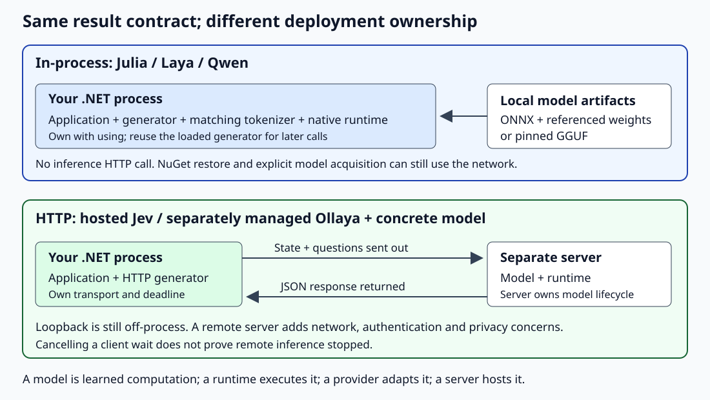

# 3. Load, deploy and evaluate responsibly

[Learning path](README.md) | Previous: [answer semantics](02-reading-answers.md)
| [Sample catalog](../../samples/README.md)

## Local and HTTP are different deployment boundaries

Text equivalent: in a **local** call, your generator prepares the data and runs
native model code in your process. In an **HTTP** call, the client sends state
and questions to another process; that server owns the model runtime. A
loopback server is on your machine but is still a separate process and privacy/
failure boundary. The server returns a JSON wire response; the .NET provider
validates and decodes it into typed C# answers. C# result objects do not literally
cross HTTP. HTTPS to a remote server adds network/service dependencies.

### Files: model, tokenizer, weights and runtime

**ONNX** is a graph interchange format. **ONNX Runtime** is software that
executes the graph; the names are not interchangeable. Weights may be embedded
in one `.onnx` file or stored as graph-declared external data. The pinned Julia
and Laya graphs require respective `.onnx.data` sidecars beside their graphs.
Not every compatible self-contained graph requires one. Missing referenced
data fails explicitly; a loader must not silently substitute another model.

Tokenizer files define the matching vocabulary/preprocessing. Laya also has a
profile for its own model contract. A similarly named file from a newer model
revision is not necessarily compatible. Preserve filenames, pins and hashes
from the quickstart's acquisition instructions.

**GGUF** is a different model/metadata format used by the Qwen/TensorSharp path.
That adapter requires one exact hash-pinned Q4_K_M artifact. Merely having
"Qwen3" or "Q4_K_M" in a filename does not establish compatibility.

NuGet restore acquires executable dependencies, not these weights. Local
inference is not proof that all initial builds/downloads are offline.
Model authors, exporters and libraries can have different licenses; review each.
Do not infer redistribution rights from the ability to download a public file.

Native CPU libraries must match the operating system/process architecture.
Julia needs both ORT and the native tokenizer binding; Laya needs native ORT;
Qwen uses its pinned TensorSharp runtime stack. Windows x64 execution was checked
here; that does not certify every runtime identifier (RID), CPU, GPU or AOT path.
All file apps explicitly disable AOT publishing rather than claim unsupported
Native AOT compatibility.

### Services: caller-owned transport

Jev is hosted. Ollaya is a server running a **selected model**, not itself a
model. Discovery of that model's supported layout matters; do not assume wire
compatibility implies semantic compatibility for every model a server offers.
The quickstarts disable automatic redirects and cookies and use an explicit
cancellation deadline. They never replace missing credentials with fixture data.

HTTP state leaves the application process. Review destination, authentication,
logging, retention and access policy before sending real data. A configured
timeout does not prove the remote computation was stopped. An exception is
failure information, not a successful prediction with zero confidence.

## Familiar .NET resource rules still apply

`LoadFromDirectory` creates an owning generator. Julia disposes its native
tokenizer and ORT session; Laya disposes its scorer/ORT session while its managed
tokenizer is non-disposable. Use `using` or a service lifetime with deterministic
shutdown. Reuse the loaded generator
for repeated requests rather than repeatedly loading weights. Do not assume
that a task's completion automatically disposes native memory.

Typed `Load(options)` supports explicit paths and an optional one-time
`ConfigureSession` callback. Paths normalize before callback execution; temporary
session options are disposed afterward and not retained for inference. With no
callback, default ORT settings remain. Advanced borrowed constructors exist,
but they require the owner to keep borrowed resources alive.

The HTTP examples own their `HttpClient` and **lend** it to the generator;
reverse `using` order disposes the borrower first. A real service should use
normal .NET HTTP lifetime management, not create a fresh network stack for each
ticket. This tutorial does not add a custom resilience/pipeline framework.

Source-generated JSON metadata is serialization infrastructure, not a decision
schema compiler or training. Portable result collections are snapshots; advanced
raw/extension metadata has separate documented ownership and portability rules.

Cancellation is **cooperative**. ORT calls request termination through its run
options; this is not a hard real-time guarantee. Qwen's synchronous
`ForwardRefill` cannot be interrupted mid-forward by its token. The local
quickstarts start inference deadlines after synchronous loading. The combined
scenario's deadline covers the sequence cooperatively but cannot interrupt
synchronous loads. Distinguish startup, preparation and inference when measuring
latency. Missing usage/resource counters mean **unknown**, not zero.

## Choose a deployment, not a leaderboard

| Provider/model | Execution | Current question support | Evidence and important limit |
|---|---|---|---|
| Julia-1 ONNX | In-process CPU ORT | Binary, Choice, Score | Native example run; strict 1,024 total/256 head/48 option tokens, Choice/Score 2-20 |
| English Laya ONNX | In-process CPU ORT | Binary, Choice, Score | Native example run; pinned 512-token profile with bounded head/options |
| Jev | Hosted TypeSafe HTTP | Binary, Choice, Score wire forms | Recorded protocol evidence; no live sample call; selected service/model may reject |
| Ollaya with `nli:modernbert-large` | Separate HTTP server/runtime | Audited NLI Binary/Choice/Score | Historical NLI live proof, no fresh tutorial live call; only audited layouts |
| Qwen3-0.6B Q4_K_M | In-process TensorSharp CPU | Choice only, 2-26 candidates | Exact-hash example run; host context 512; no mid-forward cancellation |

Ollaya's nonempty GLiClass layout is fixture-tested, not established by the NLI
live proof. Routers, fixed-schema guards, unknown layouts and the daemon Laya
layout are rejected. These distinctions are why setup stays provider-specific
even though application consumption uses one interface.

Choose based on deployment/privacy constraints, needed question kinds, operational
ownership, allowed artifacts/licenses and **evaluation on your actual task**.
Nothing in this table ranks accuracy, calibration or performance.

## Build an application-owned review policy

A high Choice probability cannot authorize an account change. First check
deterministic rules: authenticated actor, allowed operation, required data and
business constraints. Then decide how the model's signal should affect a
low-risk workflow. Some calls should always receive human review regardless of
model output.

You can add a well-described manual-review candidate, define a review rule
outside the model, or combine both. None guarantees that every unsuitable input
will abstain. Never assume the model has a hidden "unknown" option. Do not use
a universal 0.8/0.9 cutoff borrowed from an unrelated model/demo.

An evaluation process for the help-desk example:

1. Collect representative, authorized, labeled tickets with privacy controls.
   Include clear cases, ambiguity, rare categories and out-of-domain cases.
   Define labeling rules and review disagreements.
2. Separate examples used to tune descriptions/policy from a **held-out** set:
   cases you do not use to choose wording or thresholds. Otherwise your reported
   success may merely reflect repeated tuning on the test answers.
3. Compare against deterministic rules and a simple baseline, not only other
   models. Inspect a confusion matrix (actual team versus selected team) and
   each category, not just aggregate accuracy.
4. Consider error costs. A **false positive** routes to a category when it should
   not; a **false negative** misses a case that belongs there. Wrong urgent
   routing can cost more than extra manual review. For multiclass tasks, reason
   about these per category.
5. Evaluate both correctness and calibration on representative data. Choose
   review thresholds/policies against explicit error and workload costs, then
   assess them on held-out cases. Report sample sizes and uncertainty.
6. Monitor **drift**: new products, languages, wording and customer populations
   can change behavior. Record model/assets, candidate descriptions and policy
   versions, revisit reviewed mistakes, and re-evaluate deliberate changes.

A single native smoke run verifies that an example executes, not that this
evaluation has been done. Historical parity checks answer "does the adapter
match a reference computation?", which is different from "is this useful or
safe on production data?" Keep those claims separate.

## A practical next step

Run the [comparison scenario](../../samples/scenarios/CompareProviders/README.md)
on three invented tickets. Record your expected label before each run, the
returned distribution, whether any offered candidate really fits, and what
your application would do. Explain disagreements without claiming one model is
better from three cases. Then design the data you would need for a real decision.

## Glossary

| Term | Meaning here |
|---|---|
| Training / inference | Learning weights from examples / using fixed weights on a new input |
| State | Typed/JSON information to assess |
| Token / context | Model text chunk / bounded capacity for tokens and framing |
| Candidate / rubric | A described Choice alternative / ordered Score levels |
| Logit / softmax | Raw model score / normalization into relative probabilities |
| Calibration | Agreement between stated probability and observed frequency on a defined population |
| Precision | Numerical representation/rounding, not accuracy |
| Provider / runtime / server | API adapter / execution engine / separate process serving requests |
| Policy | Application-owned rules for action, review and permissions |
| Held-out data / drift | Unused evaluation examples / changes in the real input distribution |

Continue to the [technical design](../decision-generator-design.md) only when
you need architectural limits, pins or [engineering proof details](../../eng/DecisionProof/README.md).
